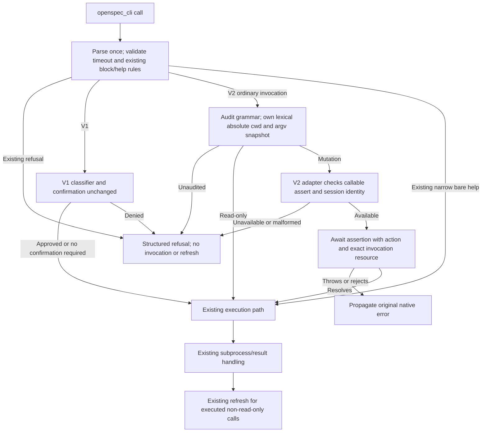

# Design

## Context

The approved proposal adds operation-specific native authorization to V2 `openspec_cli`, preserving V1 confirmation and execution behavior. Both proposal-review dispositions are incorporated below. Implementation remains gated on artifact approval.

The supplied upstream trace at `8f49790` establishes the current pipeline: parse command, validate timeout and existing blocklist, confirm destructive operations on V1, execute inside a spawn-error-converting catch, then refresh injection state for non-read-only calls, including nonzero exits and timeouts. V2 currently supplies `confirm: null` and forwards session identity without optional provenance.

OpenCode v2.0.29, commit `042d0832f5f3a73eaa039a58a7d565776f6d4290`, provides Promise-based `ctx.permission.assert(input)`. Required input fields are `sessionID`, `action`, and `resources`; optional fields include `agent`, `source`, `metadata`, and `save`. This capability is absent in v2.0.28. The verified API and policy semantics supplied by the investigation, rather than assumptions about newer SDKs, ground this design. Official documentation belongs under `/v2/docs`.

The grammar audit covers npm package `@fission-ai/openspec@1.14.1`: `dist/cli/index.js` and `dist/cli/commands/{config,schema,store,workset}.js`. OpenSpec can select roots through stores, configuration, environment, or implicit discovery. Initialization/update can regenerate or remove skills and cloud files; store removal can recursively delete a root; registry/configuration operations can write globally. Cwd is not a containment boundary.

Current `openspec/specs/tools/spec.md` and `openspec/specs/plugin/spec.md` were read. The tools contract needs full modified requirement bodies for unrestricted command execution, mutation gating, cache refresh, and existing block/help rules where V2 behavior changes. Hook error containment remains intact; native tool-authorization rejection must escape the execution boundary.

## Goals / Non-Goals

### Goals

- Authorize every supported V2 mutation before its invocation subprocess or invocation-triggered refresh.
- Distinguish creation, archive, removal, and other mutation operations through stable custom actions.
- Bind authorization to one immutable cwd/argv snapshot and preserve native rejection semantics.
- Fail closed on unaudited V2 forms and missing native capability, retaining read-only functionality where the plugin loads.
- Preserve V1, parser/executor behavior, dedicated read-only tools, context injection, and existing post-execution refresh.

### Non-Goals

- Filesystem sandboxing, symlink canonicalization, reproducing CLI root resolution, or controlling environment-selected effects.
- CLI semantic/version enforcement, generic shell authorization, SDK imports into shared logic, or a general policy framework.
- Altering relative-workdir resolution, timeout semantics, flags, block/help precedence, or refresh success criteria.
- Vendor/chezmoi edits, ai-dotfiles integration, agent/instruction files, or separately scoped cancellation handling using the verified Promise tool-context signal.

## Decisions

### 1. Authorize invocation, not inferred filesystem targets

**Options:** filesystem-target identities would express affected paths but require duplicating root selection and external-effect discovery; exact invocation identities bind the actual command without that coupling, but authorize whatever effects OpenSpec resolves at execution time.

**Recommendation:** use one resource string, `JSON.stringify([absoluteEffectiveCwd, ...immutableParsedArgv])`. This grants execution of that invocation and its CLI-resolved effects, including global/external writes, environment-selected roots, overwrite flags, and recursive deletion. It does not grant containment or freeze external configuration/environment state.

Resolve the selected workdir lexically once with `path.resolve`, preserving the existing Node relative-workdir base. Do not use realpath, rewrite symlinks, or switch relative resolution to the session directory. Parse once with the existing parser, including its handling of a leading `openspec` token. Own an immutable snapshot; classification, request metadata/resource, and execution all use identical cwd and argv values, including after a pending assertion. Do not inject or reorder arguments.

JSON serialization preserves argument boundaries and makes user operands string values, not generated permission rules. It is not permission-pattern escaping. Equivalent invocations can intentionally have different resources.

### 2. Keep native API details in the V2 adapter

**Options:** adapter-only gating risks drifting from the shared spawn path; a small injected pre-spawn authorization capability keeps one execution boundary without coupling the core to an SDK.

**Recommendation:** introduce only `src/lib/permissions.js` for V2 audited intent classification; update `src/core.js` to apply the injected authorization boundary; update `src/plugin.v2.js` to provide native authorization and verified calling context. Leave `src/lib/helpers.js`, `src/lib/exec.js`, and V1 adapters unchanged.

Existing parse, timeout, blocklist, and narrow bare-help checks retain their precedence and reasons. For ordinary V2 invocations, validate the audited grammar before calling the authorization capability. Supported read-only intents bypass mutation authorization; supported mutators await it before entering the spawn-error catch. V1 continues through its existing broad classifier and confirmation path.

The V2 adapter requires a callable `ctx.permission.assert` and actual nonempty string `sessionID` for mutation. Missing, empty, nonstring session identity or malformed capability produces a structured pre-spawn refusal, not an unguarded fallback. Invoke the host method with its required receiver preserved.

The request includes the operation action, one invocation resource, and readable `metadata` containing operation/workdir/argv. Omit `message` and `save`. Forward optional `agent` only when wellformed; forward `source: { type: 'tool', messageID, id }` only when both IDs are wellformed verified context values. Omit malformed optional provenance rather than inventing it. OpenCode v2.0.29 Promise `ToolContext` extends `Omit<Tool.Context, 'progress'>`, adding `readonly signal: AbortSignal` and `progress(update: Tool.Metadata): Promise<void>`, as verified in the installed SDK declaration and tagged `packages/plugin/src/promise/tool.ts`. `AssertInput` has no signal parameter, so no abort signal is supplied to assertion. Separate cancellation handling remains out of scope; this API correction adds no cancellation behavior.

### 3. Use a closed, version-audited V2 grammar

**Options:** a generic mutation fallback preserves arbitrary commands but cannot safely identify their operation; an explicit grammar rejects new forms until audited and exposes a predictable policy API.

**Recommendation:** the following tables are the complete in-scope inventory. Each mutating row maps to the exact action shown. Read-only commands also require audited operands and flags. No unknown token is silently dropped, and an option value or positional operand resembling a verb/help flag must not change intent classification.

Notation: `B` is a boolean flag; `V` requires an option value; brackets denote optional operands, angle brackets required operands. Global `--no-color` is `B`. Config parent `--scope` is `V` (global scope); workset parent `--json` is `B`. Standard `-h`/`--help` retains only the existing narrow bare-help exemption; mixed help does not exempt mutations or unsupported forms.

| Mutating form | Leaf options | Action |
| --- | --- | --- |
| `init [path]` | `--tools V`, `--language V`, `--force B`, `--profile V`, `--no-animation B`, `--copilot-cloud B`, `--no-copilot-cloud B` | `openspec.init` |
| `update [path]` | `--force B` | `openspec.update` |
| `new change <name>` | `--description V`, `--goal V`, `--schema V`, `--json B`, `--store V`, `--store-path V`, `--initiative V`, `--areas V` | `openspec.new.change` |
| `archive [change]` | `-y`/`--yes B`, `--skip-specs B`, `--no-validate B`, `--json B`, `--store V`, `--store-path V` | `openspec.archive` |
| `store setup [id]` | `--path V`, `--init-git B`, `--no-init-git B`, `--remote V`, `--json B` | `openspec.store.setup` |
| `store register [path]` | `--id V`, `--yes B`, `--json B` | `openspec.store.register` |
| `store unregister <id>` | `--json B` | `openspec.store.unregister` |
| `store remove <id>` | `--yes B`, `--json B` | `openspec.store.remove` |
| `workset create [name]` | repeatable `--member V`, `--tool V`, `--json B` | `openspec.workset.create` |
| `workset remove <name>` | `--yes B`, `--json B` | `openspec.workset.remove` |
| `config set <key> <value>` | `--string B`, `--allow-unknown B` | `openspec.config.set` |
| `config unset <key>` | None | `openspec.config.unset` |
| `config reset` | `--all B`, `-y`/`--yes B` | `openspec.config.reset` |
| `config profile [preset]` | None | `openspec.config.profile` |
| `schema fork <source> [name]` | `--json B`, `--force B` | `openspec.schema.fork` |
| `schema init <name>` | `--json B`, `--description V`, `--artifacts V`, `--default B`, `--no-default B`, `--force B` | `openspec.schema.init` |

| Read-only form | Leaf options |
| --- | --- |
| `version` | `--json B`, `--check B` |
| `list` | `--specs B`, `--changes B`, `--archived B`, `--all B`, `--sort V`, `--json B`, `--store V`, `--store-path V` |
| `view` | `--store V`, `--store-path V` |
| `change show [name]` | `--json B`, `--deltas-only B`, `--requirements-only B`, `--diff B`, `--no-interactive B` |
| `change list` | `--json B`, `--long B` |
| `change validate [name]` | `--strict B`, `--json B`, `--no-interactive B` |
| `validate [item]` | `--all B`, `--changes B`, `--specs B`, `--archived B`, `--report V`, `--type V`, `--strict B`, `--json B`, `--concurrency V`, `--no-interactive B`, `--store V`, `--store-path V` |
| `show [item]` | `--json B`, `--type V`, `--no-interactive B`, `--deltas-only B`, `--requirements-only B`, `--diff B`, `--requirements B`, `--no-scenarios B`, `-r`/`--requirement V`, `--store V`, `--store-path V` |
| `completion generate [shell]` | None |
| `status` | `--change V`, `--all B`, `--schema V`, `--json B`, `--store V`, `--store-path V` |
| `instructions [artifact]` | `--change V`, `--schema V`, `--json B`, `--store V`, `--store-path V` |
| `templates` | `--schema V`, `--json B` |
| `schemas` | `--json B`, `--store V`, `--store-path V` |
| `config path` | None |
| `config list` | `--json B` |
| `config get <key>` | None |
| `schema which [name]` | `--json B`, `--all B` |
| `schema validate [name]` | `--json B`, `--verbose B` |
| `store list` / `store ls` | `--json B` |
| `store doctor [id]` | `--json B` |
| `workset list` / `workset ls` | `--json B` |

Keep `config edit`, `workset open`, `completion install`, `completion uninstall`, and `feedback` blocked with existing reasons and narrow bare-help behavior. Hidden `experimental`, internal `__complete`, and unverified top-level `doctor`, `context`, and `spec` forms are unaudited. The CLI's permissive unknown-option handling for `show` does not relax the plugin grammar.

Unknown commands/subcommands/flags, operand arity errors, missing option values, and unsupported syntax return a structured refusal with `reason: 'unaudited-command'` and a CLI 1.14.1 audit hint, before assertion or subprocess. This change supports separate option/value tokens and registered single-token aliases listed above. Long-option equals syntax, option terminators (`--`), and short bundles are refused by this change. Equals signs inside ordinary operand or separately supplied option-value strings remain inert values, not unsupported option syntax. Preserve every audited table form. Any later syntax expansion requires separate evidence and tests, plus approval if it materially changes the artifacts; it is not an implementation-time option in this change.

### 4. Preserve host rejection and existing execution semantics

**Options:** converting authorization errors to ordinary results looks consistent with spawn errors but loses native control flow; propagating host errors preserves denial, decline, and corrective feedback semantics.

**Recommendation:** place native authorization outside the spawn catch and any normal-result conversion boundary. Propagate synchronous throws and asynchronous rejections unchanged, preserving exact object identity. Plain decline must end the current step through the host, not become V1-style cancellation output. Permission-service failures also fail closed. Pre-execution refusals/rejections trigger neither invocation spawn nor invocation-triggered cache refresh.

Authorized execution retains the existing executor, stdin closure, timeout and spawn-error handling. Existing non-read-only refresh remains, including nonzero exits and timeouts; failed refresh keeps previous cache state. Do not introduce success-only refresh or change independent background/context injection activity.



### 5. Native policy and compatible loading

**Options:** failing the entire plugin without the capability eliminates useful read-only behavior; scoped mutation refusal preserves that functionality without authorizing writes.

**Recommendation:** optional V2 SDK peer `>=2.0.29`, development SDK pinned to `2.0.29`, synchronized lockfile, unchanged V1 peer `>=1.15.0`. No runtime SDK imports are added. Capability checks, not version-string checks, enforce mutation safety. Older manually loaded hosts may retain read-only tools; strict peer resolution may reject installation before this fallback is reachable.

Native rules are ordered arrays of action/resource/effect; last match wins and no match asks. Configured deny precedes saved allows. Saved grants may override ask; permission hooks can affect allow/ask, not configured deny. Tool catalogue permission options are not execution authorization. Assertion therefore does not mean unconditional prompting.

```json
{
  "permissions": [
    { "action": "openspec.*", "resource": "*", "effect": "ask" },
    { "action": "openspec.new.change", "resource": "[\"/repo\",\"new\",\"change\",\"my-change\"]", "effect": "allow" },
    { "action": "openspec.store.remove", "resource": "*", "effect": "deny" }
  ]
}
```

The concrete creation rule does not authorize archive or removal. JSON escaping is configuration representation, not permission-pattern escaping. Resource rules remain wildcard patterns: copying an invocation containing pattern metacharacters into configuration may broaden its match. Do not claim arbitrary serialized resources guarantee literal equality or invent escaping syntax. Omitted `save` requests no new reusable grants, but does not defeat explicit or previously saved grants. Later matching rules can change the configured result.

### Behavioral requirements and acceptance mapping

These requirements belong in the engineer-authored tools delta spec; this document does not modify system specs.

| Contract | Acceptance evidence |
| --- | --- |
| Operation separation and full grammar | All table rows, aliases, parent/global flags, optional/required operands, value consumption and repeatable members; correct exact action; unknown/malformed forms refused before assertion; hidden/unverified forms refused |
| Existing parsing/block/help/timeout | Quoted values and leading `openspec` preserved; global options cannot bypass gating; help as value/mixed/after unsupported syntax cannot grant exemption; existing reasons/precedence retained |
| Immutable authorization/execution binding | Pending assertion with caller/context/metadata mutation attempts; resource and executed cwd/argv remain the original snapshot; lexical relative base, symlink spelling, absolute workdir and special-character operands preserved |
| Native request schema | Actual session ID, one JSON resource, readable metadata; no `message` or `save`; valid optional provenance forwarded and malformed values omitted |
| Capability refusal | Missing/non-callable assertion and missing/empty/nonstring session ID refuse mutations with zero subprocesses; supported read-only calls still execute |
| Native error propagation | Configured deny, plain decline, corrective-feedback rejection and service failure; synchronous throw and asynchronous reject preserve exact identity; zero invocation/refresh subprocesses while pending or rejected |
| Authorized execution and refresh | Allow/approval proceeds once; existing nonzero exit/spawn-error/timeout behavior preserved; refresh after executed non-read-only calls including nonzero/timeout; existing failed-refresh fallback retained |
| Runtime regression | V1 broad grammar and confirmation/cancellation unchanged; dedicated status/instructions, hooks and cleanup unchanged; package dependency floor accurately documented |

### Component breakdown

| Part | Kind of work | Done criterion |
| --- | --- | --- |
| `src/lib/permissions.js` | Application code | Closed V2 grammar yields audited read-only/mutation intents and stable actions without changing the existing parser |
| `src/core.js` execution boundary | Application code | One immutable cwd/argv snapshot is authorized before spawn; native errors escape; V1 and post-execution semantics remain intact |
| `src/plugin.v2.js` adapter | Application code | Callable/session guards and native schema/provenance are correct without SDK coupling in core |
| SDK dependency declarations and lockfile | Package configuration | V2 peer/dev versions match the approved floor; V1 peer and optional/no-runtime-import contract preserved |
| Permission intent/pipeline/adapter tests | Test code | Acceptance mapping covered in `test/permission-intent.test.js`, `test/cli-pipeline.test.js`, `test/plugin.v2.test.js`, and `test/adapter-conformance.test.js` |
| Tools delta spec, README and compatibility audit | Documentation | Conflicting requirements replaced in full; invocation effects, pattern caveats, refusals and installation/runtime distinction accurately described |

No non-trivial new user interface is introduced; native host policy/approval UI is reused, so a separate UI-design pass is unnecessary.

## Risks / Trade-offs

- **Authorization scope:** blast radius is all CLI-resolved effects of the approved invocation, not cwd. Recovery remains the CLI's existing operational/manual recovery; authorization supplies no transaction or rollback. Explicitly document global stores/configuration, generated files, environment selection, overwrite and recursive removal.
- **External state changes:** lexical cwd and argv binding prevents request drift, not changes to symlinks, environment or CLI configuration during approval. Filesystem enforcement is deliberately excluded.
- **Coverage drift:** CLI 1.14.1 is the audit baseline, not an enforced executable version. New flags are refused, but changed semantics of known forms are not detected. Re-audit registrations and implementations, verify syntax through local dependency evidence, and extend tests before expanding the grammar.
- **Host policy scope:** allow and saved permissions can avoid asking; later pattern rules can broaden access. No-save and readable invocation identities reduce plugin-generated grant risk, not host-policy risk.
- **Availability:** a permission-service failure blocks the mutation and propagates. Read-only functionality and unrelated hooks remain available; policy/capability correction enables retry. CLI failures after authorization retain existing recovery and cache behavior.
- **Scaling:** one assertion per supported mutation adds policy/approval latency, with no new service, resolver, persistent authorization state, or per-target discovery subprocess. Existing cache scalability is unchanged.
- **Compatibility:** V2 loses arbitrary command escape-hatch behavior and needs the newer peer for supported mutation functionality. V1 does not receive this breaking grammar change.

YAGNI rejections: no filesystem/root resolver duplication, hexadecimal target model, generic mutation fallback, shell permission delegation, broad save patterns, runtime SDK coupling, unconditional-prompt layer, separately scoped cancellation handling using the verified Promise context signal, relative-base migration, or unrelated cache fix. Each either exceeds the approved invocation boundary, weakens fail-closed classification, or lacks a stated need in this change; assertion itself accepts no signal parameter.

## Migration Plan

This is a plugin behavior/dependency migration, not a data migration. After artifact approval, implementation may introduce the V2 boundary and dependency floor with the acceptance mapping above. Existing V1 installations retain their current contract. Supported V2 users can keep no explicit custom rules and receive the host's no-match ask behavior, or configure narrowly reviewed operation rules. Do not install broad allows as part of the migration.

Update README and `docs/v2-compat-audit.md` alongside the behavior change; the engineer owns tools delta specs and archival into the system contract. Explain unaudited-command refusals with the 1.14.1 baseline and re-audit procedure. Installation below the V2 peer floor is not promised, even though manually loaded older contexts fail closed at runtime.

Vendor/chezmoi deployment, ai-dotfiles integration, and stale AGENTS instructions are separate follow-ups; instruction edits require their owning agent. No such file is changed by this commission.
