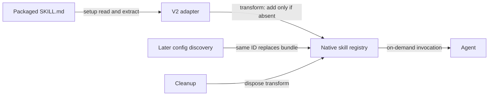

## Context

The V2 adapter currently registers tools, an event subscription, and a context hook; cleanup aborts the subscription and disposes registrations. It has no skill capability. The proposal adds one packaged workflow skill without changing shared core logic or V1.

User-confirmed boundaries: unchanged single-file copy at `skills/openspec/SKILL.md`; changes otherwise limited to the V2 adapter/tests, README, and OpenSpec artifacts. Dependencies, package settings, installed skills, AGENTS.md, and compatibility audit remain untouched. Existing plugin-spec cleanup semantics apply.

## Goals / Non-Goals

Make the packaged skill available through V2's native skill registry while preserving user customisation and existing capabilities. This is one static, approximately 21 KB asset per plugin instance, not a multi-skill distribution framework. Standalone portability and V1 skill registration are excluded.

## Decisions

### D1 — Package-relative loading and bounded extraction

Read once during setup using `new URL('../skills/openspec/SKILL.md', import.meta.url)`; convert with `fileURLToPath` for the absolute registry path. Capture parsed metadata/body outside the synchronous, replayable transform. On-demand means agent invocation through the native skill mechanism, not lazy disk access or unconditional context injection.

Choose a private, fixed-format extractor in `src/plugin.v2.js` over a YAML dependency or duplicated metadata constants. The inspected frontmatter contains exactly an unquoted `name` and one double-quoted, JSON-compatible `description`. Recognise that bounded header, decode the description with `JSON.parse`, validate nonempty metadata/body and name `openspec`, and preserve the remaining body without rewriting it. Reject unsupported header shapes rather than approximate YAML. This avoids dependency cost and metadata drift without claiming general YAML support.

### D2 — Native registration with two precedence paths

Choose `ctx.skill.transform` over installation into user directories or a custom skill tool: native discovery/invocation and disposal already exist. Construct `Skill.Info` with ID `openspec`, extracted name/description, absolute path, and body excluding frontmatter; leave optional `autoinvoke` unset.

Inside each replay, use `editor.get('openspec')` and add only when absent. This protects earlier definitions. Config-discovered skills register later and replace the bundled ID through native last-wins semantics. Unconditional replacement was rejected because installed/user skills must win, even when the bundled copy is stale.

### D3 — Isolated capability and verification

Capability-check `ctx.skill.transform`; log and skip absent capability, read/extraction failure, or registration failure without disabling tools/events/context. Guard replay edits similarly. Retain the successful registration for existing cleanup; no peer-floor change, watchers, retries, storage, or configuration switches.

Extend the fake host with an ID-keyed skill editor and replay support. Cover metadata/body/path, both precedence paths, replay, failure isolation, and existing cleanup. Tests read the repository bundle, never a developer home directory. Compare source bytes once when copying. Verify inclusion with npm pack dry-run; no manifest change is justified.

## Risks / Trade-offs

- Fixed-format extraction intentionally rejects future YAML expansion; portable tests expose drift. Repair the asset/extractor and reload to recover.
- Missing assets or unsupported hosts lose only bundled-skill availability; startup logs explain degradation. Setup performs one bounded-size read, with no per-turn I/O or session-scaled cache.
- The unchanged workflow references other skills and agent roles. README explains these prerequisites, intentional V2-only availability, and installed-skill precedence; no transitive bundles or instruction-file edits.
- Deployment is additive; rollback removes the asset/registration. Unload removes only this transform, leaving other skill definitions intact.
